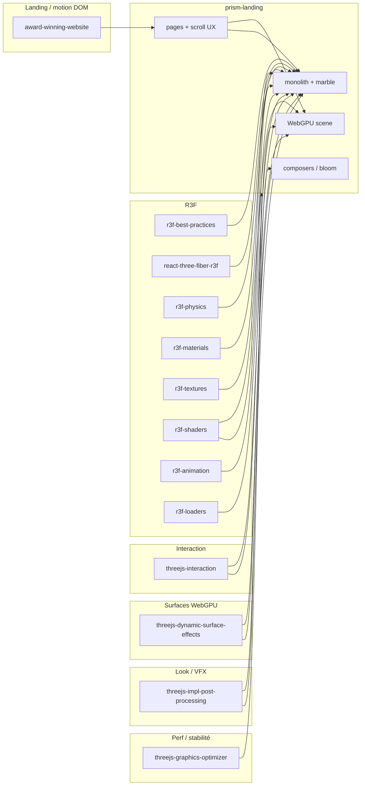

# Dashboard — Skills agent (Three.js / prism-landing)

Registre des skills installés dans ce repo pour guider l’agent sur la scène **prism-landing** et le stack **Three.js**. À enrichir au fil des paquets fournis.

**Dossier local :** `.agents/skills/`  
**Commande d’installation :** `npx skills add <repo-url> --skill <skill-id>`

---

## Vue d’ensemble

| # | Skill ID | Source | Statut | Priorité usage |
|---|----------|--------|--------|----------------|
| 1 | `threejs-graphics-optimizer` | [ovachiever/droid-tings](https://github.com/ovachiever/droid-tings) | Installé | Perf, 60fps, mobile-first |
| 2 | `threejs-impl-post-processing` | [Impertio-Studio/Three.js-Claude-Skill-Package](https://github.com/Impertio-Studio/Three.js-Claude-Skill-Package) | Installé | Bloom, composer, passes, R3F post |
| 3 | `threejs-dynamic-surface-effects` | [linegel/threejs-complete-set-of-skill](https://github.com/linegel/threejs-complete-set-of-skill) | Installé | Historique écran WebGPU/TSL, frost/touch, ping-pong |
| 4 | `threejs-interaction` | [hanzoai/video](https://github.com/hanzoai/video) | Installé | Raycast, OrbitControls, souris/touch, sélection |
| 5 | `r3f-physics` | [EnzeD/r3f-skills](https://github.com/EnzeD/r3f-skills) | Installé | Rapier, RigidBody, colliders, personnage |
| 6 | `r3f-materials` | [EnzeD/r3f-skills](https://github.com/EnzeD/r3f-skills) | Installé | PBR R3F, transmission, color spaces |
| 7 | `r3f-textures` | [EnzeD/r3f-skills](https://github.com/EnzeD/r3f-skills) | Installé | UV, colorSpace, cache useTexture, KTX2 |
| 8 | `r3f-shaders` | [EnzeD/r3f-skills](https://github.com/EnzeD/r3f-skills) | Installé | GLSL Drei, uniforms, TSL/WebGPU |
| 9 | `r3f-animation` | [EnzeD/r3f-skills](https://github.com/EnzeD/r3f-skills) | Installé | useFrame, damp, clips GLTF |
| 10 | `r3f-loaders` | [EnzeD/r3f-skills](https://github.com/EnzeD/r3f-skills) | Installé | useGLTF, Clone, Suspense, Draco/KTX2 |
| 11 | `r3f-best-practices` | [sebastianlujan/zlend](https://github.com/sebastianlujan/zlend) | Installé | Meta R3F : perf, useFrame, zustand, 60+ règles |
| 12 | `react-three-fiber-r3f` | [Vrooli/Vrooli](https://github.com/Vrooli/Vrooli) (`r3f-coherence`) | Installé manuellement | Cohérence R3F, audit re-renders, 60fps |
| 13 | `award-winning-website` | [Eng0AI/eng0-template-skills](https://github.com/Eng0AI/eng0-template-skills) | Installé | Landing GSAP, scroll, vidéo, template Eng0 |
| _14+_ | _à venir_ | _—_ | En attente | _—_ |

---

## 1. `threejs-graphics-optimizer`

| Champ | Valeur |
|-------|--------|
| **Chemin** | `.agents/skills/threejs-graphics-optimizer/SKILL.md` |
| **Install** | `npx skills add https://github.com/ovachiever/droid-tings --skill threejs-graphics-optimizer` |
| **Focus** | Optimisation perf Three.js : budget 16 ms, draw calls, LOD, textures, mémoire, boucle de rendu |
| **Quand l’utiliser** | Chutes de FPS, mobile, trop de meshes, assets lourds, thermal throttling |

**Rappels clés**

- Cible **60 FPS** (~16,67 ms / frame) ; concevoir **mobile-first**, scaler sur desktop.
- Réduire les **draw calls** (instancing, merge géométries, batching).
- **LOD**, résolution textures, `dispose()` / fuites GPU.
- Éviter le travail inutile dans la boucle d’animation.

**Liens repo cible (prism-landing)**

- Scène / rendu : `src/pages/dev/prism-landing/scene/`
- Monolithe / matériaux : `src/pages/dev/prism-landing/scene/marbleMonolithAssets.ts`, `monolith/`
- Canvas UI : `src/pages/dev/prism-landing/ui/`

---

## 2. `threejs-impl-post-processing`

| Champ | Valeur |
|-------|--------|
| **Chemin** | `.agents/skills/threejs-impl-post-processing/SKILL.md` |
| **Références** | `references/methods.md`, `examples.md`, `anti-patterns.md` |
| **Install** | `npx skills add https://github.com/Impertio-Studio/Three.js-Claude-Skill-Package --skill threejs-impl-post-processing` |
| **Note** | Le nom `threejs-impl-post-processing-impertio-studio` n’existe pas dans le dépôt ; utiliser `threejs-impl-post-processing`. |
| **Focus** | `EffectComposer`, ordre des passes, pmndrs vs three/addons, WebGPU TSL |
| **Quand l’utiliser** | Bloom, SSAO/GTAO, DOF, AA, god rays, pipeline couleur / tone mapping |

**Rappels clés**

- **Ne pas mélanger** `three/addons/postprocessing` et `postprocessing` (pmndrs) dans le **même** composer.
- Ordre built-in : `RenderPass` → effets → AA → `OutputPass`.
- Rendu : `composer.render()` uniquement ; resize : `composer.setSize()`.
- WebGPU : `PostProcessing` TSL, pas les passes WebGL classiques.

**Liens repo cible (prism-landing)**

- pmndrs : `monolith/monolithColorPipeline.ts`, `components/MonolithGodrays.tsx`
- Three.js addons : `scene/cubeEnvironment.ts`, `scene/createCosmicMonolithScene.ts`

---

## 3. `threejs-dynamic-surface-effects`

| Champ | Valeur |
|-------|--------|
| **Chemin** | `.agents/skills/threejs-dynamic-surface-effects/SKILL.md` |
| **Références** | `references/ping-pong-accumulation.md` |
| **Install** | `npx skills add https://github.com/linegel/threejs-complete-set-of-skill --skill threejs-dynamic-surface-effects` |
| **Focus** | Effets de surface dynamiques **WebGPU + TSL** : historique viewport (touch, givre, dégel), ping-pong `StorageTexture`, composite + refraction |
| **Quand l’utiliser** | Traînées persistantes à l’écran, dépôts sparse/full-field, blur séparable réduit, refraction pilotée par l’historique |

**Rappels clés**

- Chemin canonique : `WebGPURenderer` (`three/webgpu`), `await renderer.init()`, `isWebGPUBackend === true`.
- Graphe : signaux + événements → **compute** mise à jour historique → swap → **une** passe scène (blur optionnel → structure statique + historique → refraction → `RenderPipeline.outputNode`).
- `dt` invariant (30/60/120 Hz) ; reset sur resize / seek / changement de projection ou génération de ressources.
- Topologies : full-field ping-pong, tuiles sales, catch-up analytique ; **idle = pas de dispatch** si l’état est inchangé.
- Skills liés (même dépôt linegel, à installer si besoin) : particules/trails, pluie/neige, eau, image-pipeline, fallbacks compat.

**Liens repo cible (prism-landing)**

- WebGPU : `scene/createMonolithWebgpuScene.ts`
- Marbre / surface : `scene/marbleMonolithAssets.ts`, `components/MarbleMonolith.tsx`
- Eau / textures : `assets/textures/Water.mtlx`, `scene/atmosphere.ts`

---

## 4. `threejs-interaction` (hanzoai/video)

| Champ | Valeur |
|-------|--------|
| **Chemin** | `.agents/skills/threejs-interaction/SKILL.md` |
| **Install** | `npx skills add https://github.com/hanzoai/video --skill threejs-interaction` |
| **Note** | L’ID `threejs-interaction-hanzoai` **n’existe pas** dans ce dépôt ; le skill s’appelle `threejs-interaction`. |
| **Focus** | `Raycaster`, conversion souris/canvas, touch, `OrbitControls` / contrôles caméra, sélection d’objets, expériences interactives |
| **Quand l’utiliser** | Clics 3D, hover, drag caméra, picking sur le monolithe, UI + canvas, locomotion pilotée par input |

**Rappels clés**

- Coordonnées NDC : utiliser **`getBoundingClientRect()`** sur le canvas (pas seulement `window.innerWidth`).
- `raycaster.intersectObjects(list, recursive)` ; seuils `Line` / `Points` ; `instanceId` pour `InstancedMesh`.
- `OrbitControls` : `enableDamping` + `controls.update()` dans la boucle d’animation.
- Touch : `preventDefault` si besoin ; gérer multi-touch séparément des contrôles caméra.

**Autres skills Three.js dans le même repo (non installés)** : `threejs-fundamentals`, `threejs-animation`, `threejs-postprocessing`, `threejs-materials`, etc.

**Liens repo cible (prism-landing)**

- Caméra / travelling : `camera/landingTravellingRig.ts`, `camera/cameraPath.ts`
- Locomotion : `locomotion/thirdPersonWalk.ts`, `locomotion/povWalk.ts`
- Canvas : `ui/MonolithLandingCanvas.tsx`, `ui/PrismLandingCanvas.tsx`
- Layout éditeur : `pages/PrismLayoutPage.tsx`

---

## 5. `r3f-physics` (EnzeD / React Three Fiber)

| Champ | Valeur |
|-------|--------|
| **Chemin** | `.agents/skills/r3f-physics/SKILL.md` |
| **Références** | `references/controllers.md` |
| **Install** | `npx skills add https://github.com/EnzeD/r3f-skills --skill r3f-physics` |
| **Note** | L’ID `r3f-physics-enzed` **n’existe pas** ; utiliser `r3f-physics`. |
| **Focus** | `@react-three/rapier` : `Physics`, `RigidBody`, colliders, forces, sensors, joints, character controller |
| **Quand l’utiliser** | Collisions, gravité, plateformes kinematic, props interactifs ; **pas** pour la marche purement animée (voir `r3f-animation` / locomotion custom) |

**Rappels clés**

- `Suspense` autour de `<Physics>` (WASM async) ; `timeStep` fixe (ex. `1/60`) pour stabilité.
- **CuboidCollider `args` = demi-extents** ; ne pas animer la position du mesh simulé dans `useFrame`.
- `colliders={false}` + colliders manuels pour éviter les doublons ; debug Rapier pour alignement.
- Impulsion vs force persistante ; `useBeforePhysicsStep` pour l’input aligné sur la simu.
- Mouvement personnage : **character controller Rapier**, distinct du simple `setTranslation` sur un dynamic body.

**Autres skills dans le même repo (non installés)** : `r3f-fundamentals`, `r3f-postprocessing`, `r3f-interaction`, `r3f-animation`, etc.

**Liens repo cible (prism-landing)**

- R3F existant : `components/MonolithScene.tsx`, `MarbleMonolith.tsx`, `ShatteredCube.tsx`
- Locomotion actuelle (non-Rapier) : `locomotion/thirdPersonWalk.ts`, `character/prismLandingCharacter.ts`
- Surface terrain : `layout/landingTerrainHeight.ts`, `locomotion/walkSurface.ts`

---

## 6. `r3f-materials` (EnzeD / React Three Fiber)

| Champ | Valeur |
|-------|--------|
| **Chemin** | `.agents/skills/r3f-materials/SKILL.md` |
| **Install** | `npx skills add https://github.com/EnzeD/r3f-skills --skill r3f-materials` |
| **Note** | L’ID `r3f-materials-enzed` **n’existe pas** ; utiliser `r3f-materials`. |
| **Focus** | Matériaux R3F : choix Standard/Physical/Basic, PBR, espaces couleur, transparence, verre (`transmission`), Drei transmission/reflector |
| **Quand l’utiliser** | Marbre, métal, vitres du portail, partage/clone de matériaux ; shaders custom → `r3f-shaders` |

**Rappels clés**

- Matériau **le plus simple** qui suffit ; `meshPhysicalMaterial` seulement si clearcoat/transmission/sheen requis.
- **sRGB** : albedo/emissive ; **NoColorSpace** : roughness, metalness, normal, AO.
- Métaux : besoin d’**Environment** / IBL ; émissif ≠ bloom automatique.
- Verre : `transmission` + `thickness`/IOR ; `MeshTransmissionMaterial` = coût render extra — profiler avant.
- Partager les matériaux ; **cloner** avant mutation ; `dispose()` ne libère pas les textures.

**Liens repo cible (prism-landing)**

- Marbre / PBR : `scene/marbleMonolithAssets.ts`, `components/MarbleMonolith.tsx`
- Pipeline monolithe : `monolith/monolithVisualContract.ts`, `monolith/monolithColorPipeline.ts`
- Textures : `assets/textures/marble/`
- R3F meshes : `components/MonolithScene.tsx`

---

## 7. `r3f-textures` (EnzeD / React Three Fiber)

| Champ | Valeur |
|-------|--------|
| **Chemin** | `.agents/skills/r3f-textures/SKILL.md` |
| **Références** | `references/render-targets.md` |
| **Install** | `npx skills add https://github.com/EnzeD/r3f-skills --skill r3f-textures` |
| **Note** | L’ID `r3f-textures-enzed` **n’existe pas** ; utiliser `r3f-textures`. |
| **Focus** | `useTexture` / cache Drei, color spaces, UV channels, wrapping/mipmaps, vidéo, render targets |
| **Quand l’utiliser** | Maps marbre orange, orientation UV, fuites cache, taille GPU, remplacement textures glTF |

**Rappels clés**

- **SRGBColorSpace** : couleur / emissive ; **NoColorSpace** : données scalaires (≠ LinearSRGB).
- `useTexture` **cache partagé** : cloner avant repeat/offset/colorSpace par instance ; ne pas `dispose()` la texture cache.
- `texture.channel` → `uv` / `uv1`… ; repeat exige `RepeatWrapping`.
- glTF : respecter metadata loader ; remplacement manuel souvent `flipY=false`.
- KTX2/Basis si supporté ; ne pas sampler une RT pendant qu’on y rend.

**Liens repo cible (prism-landing)**

- Chargement marbre : `scene/marbleMonolithAssets.ts`
- Fichiers : `assets/textures/marble/Marble_Orange_Streaks_*.png`
- R3F : `components/MonolithScene.tsx` (`useTexture`)
- Complément : skill #6 `r3f-materials` pour brancher les maps sur les matériaux

---

## 8. `r3f-shaders` (EnzeD / React Three Fiber)

| Champ | Valeur |
|-------|--------|
| **Chemin** | `.agents/skills/r3f-shaders/SKILL.md` |
| **Références** | `references/webgpu.md` |
| **Install** | `npx skills add https://github.com/EnzeD/r3f-skills --skill r3f-shaders` |
| **Note** | L’ID `r3f-shaders-enzed` **n’existe pas** ; utiliser `r3f-shaders`. |
| **Focus** | `shaderMaterial` (Drei), uniforms animés, GLSL WebGL, `onBeforeCompile`, node materials / TSL pour WebGPU |
| **Quand l’utiliser** | Déformation vertex, effets custom sur mesh R3F ; pas pour PBR standard ni composer (voir skills post/matériaux) |

**Rappels clés**

- Préférer matériaux built-in ; shader custom = pas de lumière/ombre/fog automatiques.
- **WebGPU** : TSL / node materials — GLSL `ShaderMaterial` **non portable**.
- Uniforms : muter en `useFrame`, pas de `setState` ; pas de `needsUpdate` pour une valeur seule.
- Frag : `#include <tonemapping_fragment>` + `<colorspace_fragment>` si rendu direct canvas.
- GLSL dans template literals : **pas de backticks** dans les commentaires shader.
- `onBeforeCompile` : version-sensitive ; `customProgramCacheKey` si le GLSL change.

**Liens repo cible (prism-landing)**

- God rays custom : `components/MonolithGodrays.tsx` (`postprocessing` Effect)
- Pipeline vanilla / shaders : `scene/createCosmicMonolithScene.ts` (`ShaderPass`)
- WebGPU TSL : `scene/createMonolithWebgpuScene.ts` + skill #3 `threejs-dynamic-surface-effects`
- Complément : #6 matériaux, #7 textures

---

## 9. `r3f-animation` (EnzeD / React Three Fiber)

| Champ | Valeur |
|-------|--------|
| **Chemin** | `.agents/skills/r3f-animation/SKILL.md` |
| **Références** | `references/clips.md` |
| **Install** | `npx skills add https://github.com/EnzeD/r3f-skills --skill r3f-animation` |
| **Note** | L’ID `r3f-animation-enzed` **n’existe pas** ; utiliser `r3f-animation`. |
| **Focus** | `useFrame`, `MathUtils.damp`, `frameloop="demand"` + `invalidate`, `useAnimations` (GLTF), ownership vs Rapier |
| **Quand l’utiliser** | Locomotion visuelle R3F, transitions, clips FBX/GLTF personnage ; collisions → skill #5 `r3f-physics` |

**Rappels clés**

- **État React** = objectifs discrets ; **refs + useFrame** = mouvement continu.
- Intégrer avec **`delta`** ; `MathUtils.damp` ou `1 - exp(-λ * delta)` — pas un lerp fixe par frame.
- Réutiliser Vector3/Quaternion ; pas d’alloc par frame.
- `frameloop="demand"` : appeler `invalidate()` tant que l’animation bouge.
- Cacher un mesh **n’arrête pas** `useFrame` / mixer — pauser explicitement.
- Rapier possède les transforms simulés ; kinematic via APIs physics.

**Liens repo cible (prism-landing)**

- Personnage / FBX : `character/prismLandingCharacter.ts`, `character/prismLandingCharacterAnimations.ts`
- Locomotion (vanilla) : `locomotion/thirdPersonWalk.ts`, `locomotion/povWalk.ts`
- R3F `useFrame` : `components/MarbleMonolith.tsx`, `ShatteredCube.tsx`, `MonolithGodrays.tsx`

**EnzeD restants (non installés)** : `r3f-fundamentals`, `r3f-geometry`, `r3f-interaction`, `r3f-lighting`, `r3f-postprocessing`

---

## 10. `r3f-loaders` (EnzeD / React Three Fiber)

| Champ | Valeur |
|-------|--------|
| **Chemin** | `.agents/skills/r3f-loaders/SKILL.md` |
| **Install** | `npx skills add https://github.com/EnzeD/r3f-skills --skill r3f-loaders` |
| **Note** | L’ID `r3f-loaders-enzed` **n’existe pas** ; utiliser `r3f-loaders`. |
| **Focus** | `useGLTF`, `useLoader`, `Suspense`, preload, `Clone`, cache partagé, Draco/Meshopt/KTX2, error boundaries |
| **Quand l’utiliser** | GLB personnage, terrain, prism GLTF, instances multiples, décodeurs compressés |

**Rappels clés**

- Hooks loaders **suspendent** → `Suspense` ; preload avant interaction, pas tout le catalogue.
- Résultat cache = **partagé** : `Clone` pour répéter ; un `Object3D` ne peut pas avoir deux parents.
- `dispose={null}` sur sous-arbre partagé ; ne pas muter le scene cache pour le setup local.
- Draco/Meshopt/KTX2 : config **identique** preload + load ; workers pas recréés à chaque render.
- Suspense ≠ erreurs réseau → **error boundary** + retry ; `useProgress` ≠ bytes exacts.

**Liens repo cible (prism-landing)**

- GLB/GLTF : `assets/gltf/`, `assets/character/cartoon_young_boy.glb`, `assets/prime-landing-v2/`
- FBX (vanilla, hors useGLTF) : `character/prismLandingCharacterFbx.ts`
- R3F : `components/MonolithScene.tsx` (`useGLTF`, `useTexture`)
- Complément : #7 textures, #9 animation (`useAnimations`)

---

## 11. `r3f-best-practices` (zlend / Poimandres)

| Champ | Valeur |
|-------|--------|
| **Chemin** | `.agents/skills/r3f-best-practices/SKILL.md` |
| **Règles détaillées** | `rules/*.md` (ex. `perf-never-set-state-in-useframe.md`, `frame-delta-time.md`, `loading-suspense.md`, `drei-use-gltf.md`) |
| **Install** | `npx skills add https://github.com/sebastianlujan/zlend --skill r3f-best-practices` |
| **Focus** | Guide transversal R3F + Drei + zustand + `@react-three/postprocessing` + Rapier + leva — **re-renders = ennemi #1** |
| **Quand l’utiliser** | Revue/optimisation de tout composant Canvas R3F ; complète les skills EnzeD par domaine |

**Rappels clés (priorité CRITICAL)**

- **Jamais `setState` dans `useFrame`** — muter refs / uniforms.
- **Zustand** : sélecteurs fins ou `getState()` dans la frame ; pas tout le store.
- **`delta`** pour toute animation ; `invalidate()` si `frameloop="demand"`.
- Suspense + preload `useGLTF` ; `dispose={null}` sur ressources partagées.
- Désactiver / pauser `useFrame` quand inutile ; isoler l’état React hors hot path.

**Cartographie avec skills déjà installés**

| zlend (catégorie) | Skill détaillé local |
|-------------------|----------------------|
| perf / frame | #9 `r3f-animation`, #1 `threejs-graphics-optimizer` |
| loading | #10 `r3f-loaders` |
| materials / textures | #6 `r3f-materials`, #7 `r3f-textures` |
| shaders / postpro | #8 `r3f-shaders`, #2 `threejs-impl-post-processing` |
| physics | #5 `r3f-physics` |
| events | #4 `threejs-interaction` |

**Dépôt zlend** : 6 skills au total (les 5 autres non installés — lister via `npx skills add …` sans `--skill` si besoin).

**Liens repo cible (prism-landing)**

- Tous les composants R3F : `components/MonolithScene.tsx`, `MarbleMonolith.tsx`, `MonolithGodrays.tsx`, `ShatteredCube.tsx`
- Canvas : `ui/MonolithLandingCanvas.tsx`, `ui/PrismLandingCanvas.tsx`

---

## 12. `react-three-fiber-r3f` (Vrooli — `r3f-coherence`)

| Champ | Valeur |
|-------|--------|
| **Chemin** | `.agents/skills/react-three-fiber-r3f/SKILL.md` |
| **Métadonnées** | `.agents/skills/react-three-fiber-r3f/skill.json` |
| **Source repo** | `scenarios/prompt-manager/store/skills/packs/core/r3f-coherence/` |
| **Install CLI** | `npx skills add https://github.com/Vrooli/Vrooli --skill react-three-fiber-r3f` → **échoue** (pas de frontmatter `name`/`description` dans Vrooli) |
| **Install effectif** | Copie manuelle + frontmatter ; ID Vrooli réel = **`r3f-coherence`** |
| **Focus** | Steer « cohérence R3F » : tension React vs Three.js, zustand, isolation composants, chargement assets, checklist audit |
| **Quand l’utiliser** | Revue architecture R3F landing ; complète #11 `r3f-best-practices` (règles courtes) par guide long format steer |

**Rappels clés**

- Ennemi #1 : **re-renders** (surtout `setState` dans `useFrame`).
- Mutations impératives Three.js via **refs** ; état React pour intentions, pas pour positions frame-à-frame.
- Souscription store **granulaire** ; pas d’objets inline dans le JSX 3D.
- Charger assets de façon **async** (Suspense) ; ne pas bloquer le thread principal.
- Skill Vrooli référence `visited-tracker-tools` (outil interne Vrooli) — ignorer hors monorepo Vrooli.

**Liens repo cible (prism-landing)**

- Même périmètre que #11 : composants R3F + canvas UI prism-landing

---

## 13. `award-winning-website` (Eng0 — landing / motion)

| Champ | Valeur |
|-------|--------|
| **Chemin** | `.agents/skills/award-winning-website/SKILL.md` |
| **Install** | `npx skills add https://github.com/Eng0AI/eng0-template-skills --skill award-winning-website` |
| **Template associé** | [Eng0AI/award-winning-website-template](https://github.com/Eng0AI/award-winning-website-template) |
| **Focus** | Landing « award » : **GSAP** scroll, transitions géométriques, hover 3D, storytelling vidéo ; stack React 19 + Vite + Tailwind |
| **Quand l’utiliser** | Direction UX scroll de la landing, sections hero, motion DOM autour du canvas 3D — **pas** pour remplacer la scène Three.js existante |

**Sécurité (skills CLI)** : évaluation **High / Critical** sur [skills.sh](https://skills.sh/Eng0AI/eng0-template-skills) — relire le skill avant exécution de commandes clone/deploy qu’il suggère.

**Rappels clés**

- Skill = **guide + workflow template** ; ne pas cloner le template dans `neural-aegis-suite` sans demande explicite.
- Animations scroll : **GSAP** ; aligner avec perf mobile (#1 `threejs-graphics-optimizer`).
- Deploy Vercel dans le skill : `vercel build --prod` puis `vercel deploy --prebuilt --prod` (pas `vercel --prod` direct).
- Site statique, pas de backend ; le skill dit de ne pas lancer `npm run dev` en VM agent.

**Liens repo cible (prism-landing)**

- Pages : `pages/PrismLandingPage.tsx`, `pages/PrismLayoutPage.tsx`
- Styles : `styles/prism-landing.css`, `styles/prism-layout.css`
- Cinématique / scroll : `docs/LANDING_CINEMATIC_BIBLE.md`, `camera/landingTravellingRig.ts`
- Complément 3D : skills #2 post-pro, #4 interaction, travelling caméra

**Dépôt eng0-template-skills** : 49 skills (les autres non installés).

---

## File d’attente (prochains skills)

Coller ici chaque commande `npx skills add …` reçue ; l’agent mettra à jour ce dashboard après installation.

```text
# Exemple
# npx skills add https://github.com/... --skill mon-skill-id
```

| Date (approx.) | Commande / skill ID | Statut |
|----------------|---------------------|--------|
| 2026-10-21 | `threejs-graphics-optimizer` (droid-tings) | Fait |
| 2026-10-21 | `threejs-impl-post-processing` (Impertio) | Fait |
| 2026-10-21 | `threejs-dynamic-surface-effects` (linegel) | Fait |
| 2026-10-21 | `threejs-interaction-hanzoai` → installé comme `threejs-interaction` (hanzoai/video) | Fait |
| 2026-10-21 | `r3f-physics-enzed` → installé comme `r3f-physics` (EnzeD/r3f-skills) | Fait |
| 2026-10-21 | `r3f-materials-enzed` → installé comme `r3f-materials` (EnzeD/r3f-skills) | Fait |
| 2026-10-21 | `r3f-textures-enzed` → installé comme `r3f-textures` (EnzeD/r3f-skills) | Fait |
| 2026-10-21 | `r3f-shaders-enzed` → installé comme `r3f-shaders` (EnzeD/r3f-skills) | Fait |
| 2026-10-21 | `r3f-animation-enzed` → installé comme `r3f-animation` (EnzeD/r3f-skills) | Fait |
| 2026-10-21 | `r3f-loaders-enzed` → installé comme `r3f-loaders` (EnzeD/r3f-skills) | Fait |
| 2026-10-21 | `r3f-best-practices` (sebastianlujan/zlend) | Fait |
| 2026-10-21 | `react-three-fiber-r3f` (Vrooli) — CLI KO → install manuel depuis `r3f-coherence` | Fait |
| 2026-10-21 | `award-winning-website` (Eng0AI/eng0-template-skills) | Fait |
| | | |

---

## Carte rapide : quel skill pour quoi ?



---

## Perf landing (implémentation repo)

Mapping skills → fichiers pour le profil **optimized** (`/dev/prism-landing-opt`) sans toucher la golden route :

| Skill | Fichiers |
|-------|----------|
| `threejs-graphics-optimizer` | `scene/prismLandingPerformance.ts` (DPR, pause onglet, throttle idle) ; `createCosmicMonolithScene.ts` (branche optimized) |
| `threejs-impl-post-processing` | `createCosmicMonolithScene.ts` — resize composer / passes inchangé ; pas de second `renderer.render` |
| `r3f-best-practices` / `react-three-fiber-r3f` | `ui/PrismLandingCanvas.tsx` — sync UI pathU throttlée (~200 ms) |
| `r3f-animation` | idle skip render (simulation continue) dans la boucle monolithe |

Pages annexes : `PrismLayoutPage.tsx`, `ShatteredCubeDevPage.tsx` — `attachVisibilityPauseRaf` + `resolveRendererPixelRatio("optimized")`.

---

## Maintenance

- Après chaque nouveau skill : ajouter une ligne au tableau, une section numérotée, et une entrée dans la file d’attente.
- Vérifier que le skill apparaît sous `.agents/skills/<skill-id>/`.
- Ne pas committer de secrets ; les skills sont du texte d’instruction uniquement.
