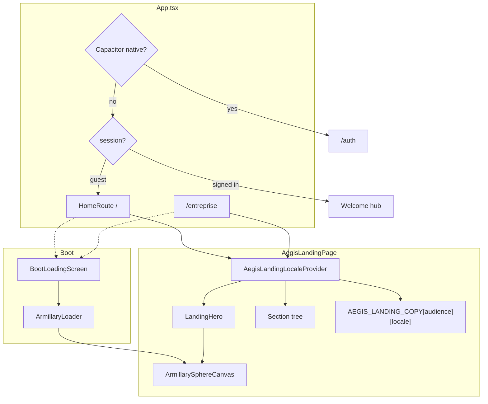
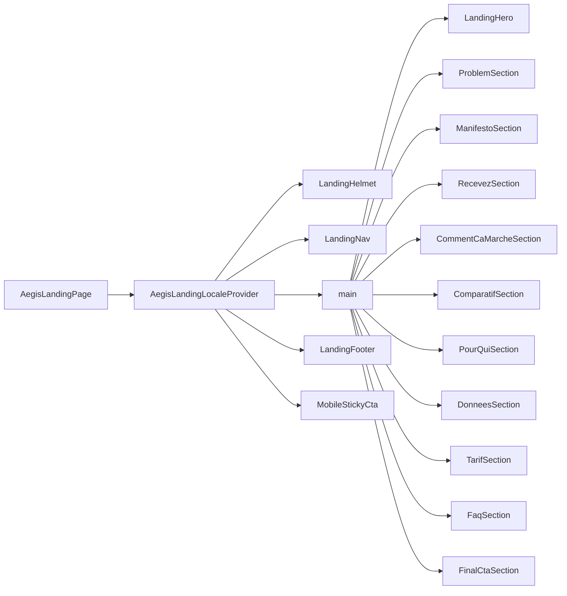
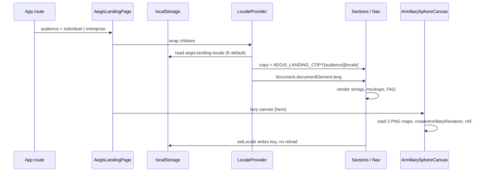
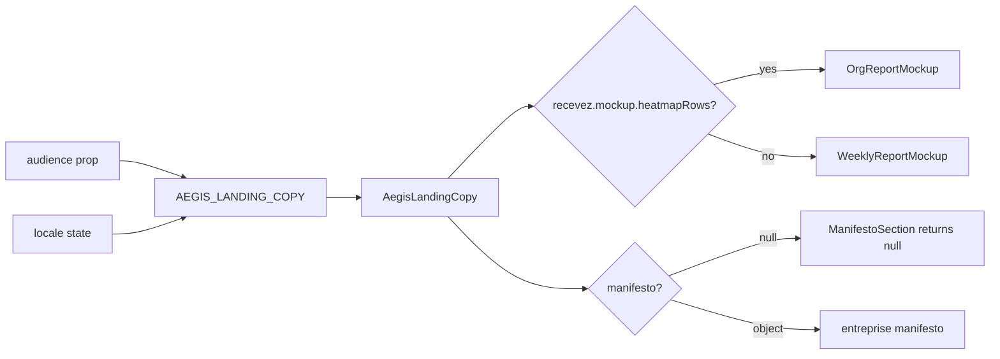

# AEGIS landing — architecture

Living map of `src/pages/aegis-landing/`. Source of truth is the TypeScript in this folder, not the mockups.

## System

`AegisLandingPage` is lazy-loaded from `App.tsx`. The same canvas module drives both the hero (locked camera, no pointer events) and the boot loader (closer camera, slow azimuth).

## Component tree

Every section and chrome component reads `useAegisLandingLocale()`. There is no page-level React state besides locale.

## Data flow

Audience is a **route**, not stored state. Switching Individuel / Entreprise is a React Router navigation (`/` ↔ `/entreprise`). Locale survives that navigation because it lives in `localStorage`.

## Copy selection

## File map

| Path | Role |
| --- | --- |
| `AegisLandingPage.tsx` | Shell, Helmet, section order |
| `aegisLanding.css` | Tokens, container, hero wash, reduced-motion reveals |
| `copy-deck.md` | FR copy brief (design source, not runtime) |
| `i18n/aegisLandingCopy.ts` | Runtime copy + types |
| `i18n/AegisLandingLocaleProvider.tsx` | Context, persistence, `lang` |
| `armillary/` | WebGL renderer — see [ARMILLARY.md](ARMILLARY.md) |
| `components/` | Presentational chrome (nav, cards, mockups, CTA) |
| `sections/` | One file per landing block |

### Components

| File | Notes |
| --- | --- |
| `LandingNav` | Hash links `#comment` `#pour-qui` `#tarif` `#faq`; hamburger below `lg`; audience `Link`s |
| `LandingHero` | JPEG still always + cream veil; lazy WebGL from 1024px, `interactive={false}`, `adaptFraming` |
| `LandingBootFallback` | Static wordmark for landing Suspense — no WebGL |
| `ArmillaryLoader` | `LOADER_CAM` + `LOADER_CAM_SPEED` (0.16) |
| `LandingSection` | Optional `id` / label / title; `dark` flips ink |
| `RevealOnScroll` | One-shot IntersectionObserver; skipped if reduced motion |
| `LandingButton` | `<a>` with variants `dark` \| `bronze` \| `ghost` |
| `WeeklyReportMockup` | Individuel recevez visual |
| `OrgReportMockup` / `OrgNetworkDiagram` | Entreprise recevez visual |
| `MobileStickyCta` | Fixed bar, `sm:hidden`, safe-area padding |
| `LandingFooter` | Legal `Link`s from copy (`/legal/mentions`, terms, privacy, refund) |

## Design tokens

Defined in `aegisLanding.css` on `.aegis-landing`:

| Token | Value | Use |
| --- | --- | --- |
| `--aegis-page` | `#f3eeec` | Page wash |
| `--aegis-text` | `#121212` | Primary ink |
| `--aegis-bronze` | `#d19d7b` | Fill, dark-section labels |
| `--aegis-bronze-ink` | `#8a5a3c` | Text on light (4.5:1+) |
| `--aegis-dark` | `#0c1418` | Dark sections |
| `--aegis-dark-text` | `#f8f1ec` | Dark-section type |

Headlines use `.aegis-landing__headline` (Cormorant Garamond). Section labels use `.aegis-landing__section-label` (DM Mono + bronze rule).

Families come from `index.html` (Barlow, Cinzel, Cormorant, DM Mono). Helmet only sets title, description, OG, and `theme-color`.

## Accessibility

- Skip link to `#aegis-landing-main`; focus ring: `.aegis-landing :focus-visible` bronze outline
- Touch targets: nav language/audience/hash links/CTA use `min-h-[44px]`
- `aria-current` on audience, `aria-pressed` on FR/EN
- Canvas is `aria-hidden`; hero chip is duplicated in `.sr-only`
- `prefers-reduced-motion: reduce` snaps ring eulers, zeros hover, and disables reveal transforms
- FAQ uses `LandingAccordion` (expand/collapse)

## Constraints

- **No** imports from `src/pages/dev/prism-landing/**` or `prism-landing-r3f/**`
- **No** Three / R3F in this folder — the armillary is a small WebGL 1 renderer
- CTAs currently hash-scroll to `#tarif`. There is no lead-capture form on the page
- Native apps never mount this page from `HomeRoute`

## Scalability / reliability

The page is static: copy is bundled, textures are public WebP, no extra font request from Helmet. Failure modes:

| Failure | Behaviour |
| --- | --- |
| WebGL unavailable / texture 404 | Canvas `onError`; JPEG still remains visible |
| Viewport under 1024px | WebGL not mounted; still only |
| `localStorage` blocked | Locale defaults to `fr`; writes are swallowed |
| Backend degraded on auth boot | `BootLoadingScreen` shows a retry alert over the loader |
