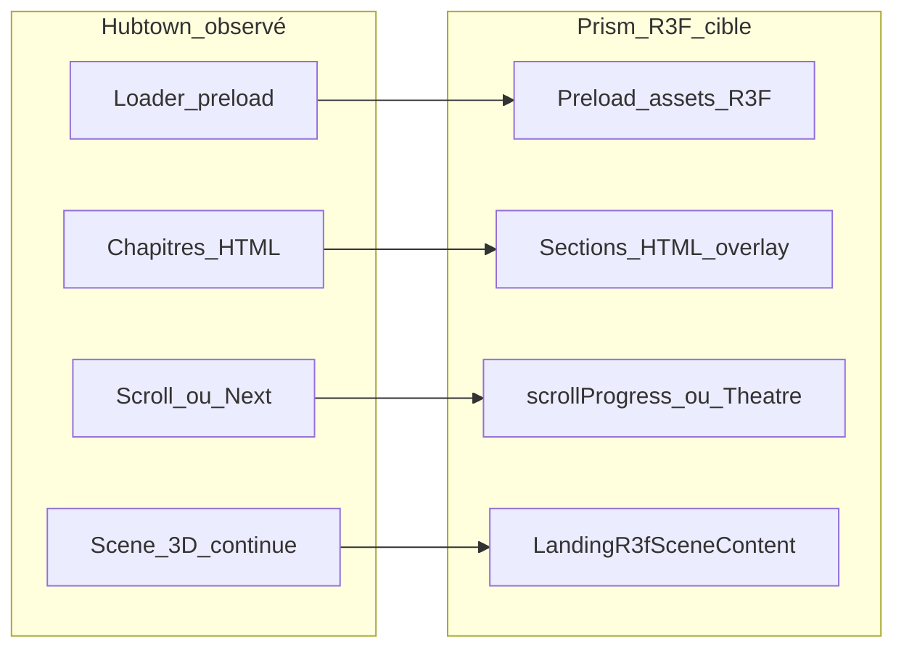

# Audit de référence — Hubtown (hubtown.co.in)

Spécification de **comportement produit** observée sur la landing Hubtown, destinée à alimenter la future landing Prism 3D (R3F). Aucune copie de contenu marketing final — patterns d’interaction et de mise en scène uniquement.

---

## 1. Résumé exécutif

Hubtown propose une **expérience immersive full-viewport** pour un promoteur immobilier indien : une scène **3D WebGL continue** (Three.js) avec **chapitres narratifs** pilotés par le bas de l’écran (NEXT / PREV.), pas par un défilement de page classique. Le public visé est **B2C / investisseurs / recrutement** (liens Projects, Careers, Investor Relations dans le menu).

Sur **desktop** (~722×729 px dans l’audit Cursor), l’UI est un **HUD** (cadre fin, coins biseautés) : logo, LOGIN, MENU, texte hero à gauche, barre de navigation chapitre en bas, son et WhatsApp. Le **loader** bloque l’entrée avec pourcentage et libellé « LOADING CONTENT ».

Sur **mobile** (~390 px), le même HUD se **réorganise en colonne** ; le canvas 3D reste visible derrière le texte (voir capture mobile). Le menu ouvre un **panneau plein écran** lavande qui **masque** la 3D.

**Limites de l’audit :** `prefers-reduced-motion` non testé ; stats type « 09 PROJECTS » non trouvées dans le texte DOM (éventuellement rendu uniquement dans la scène 3D). La capture `02-loader-100pct.png` correspond à l’**écran hero post-loader** (le loader à 100 % n’a pas été figé en image dédiée).

---

## 2. Timeline utilisateur

1. **Arrivée URL** — Document Nuxt ; titre SEO « Hubtown Limited | Leading Real Estate Developer in India ».
2. **Loader** — Fond bleu nuit ; rangée de carrés animés ; **0 % → 100 %** + « LOADING CONTENT » ; durée perçue **~15–30 s** au premier chargement (plus rapide en revisitant avec cache). Pas de CTA pendant le loader.
3. **Révélation hero** — Transition vers la scène 3D ; chapitre **FUTURE** ; barre **NEXT** seule (pas de PREV.).
4. **Exploration chapitres** — Clic **NEXT** (zone cliquable `cursor: pointer` sur le libellé NEXT) ou **PREV.** à partir du chapitre 2 ; animation caméra / environnement **~3–5 s** entre chapitres.
5. **CTA chapitre** — Liens type « EXPLORE OUR PROJECTS », « WORK WITH US », « DISCOVER OUR VISION » (sortie vers sections du site ou pages dédiées).
6. **Menu** — Overlay modal ; navigation site + liens légaux numérotés 01–06 ; fermeture **CLOSE** / Escape.
7. **Son** — Par défaut **Sound Off** ; bascule **Sound On** au clic (icône haut-parleur bas gauche).
8. **Chat** — Lien **Chat with us** (WhatsApp), coin bas droit.
9. **LOGIN** — Bouton header (non testé en profondeur ; pas de credentials saisis).

---

## 3. Chapitres

| # | Nom visible | Texte hero (extrait) | Interaction pour y arriver | Changement visuel perçu (caméra, fond, transition) |
|---|-------------|----------------------|----------------------------|-----------------------------------------------------|
| 1 | **FUTURE** | « WE BUILD THE FUTURE OF REAL ESTATE » — historique 40 ans, résidentiel / commercial / industriel | Entrée après loader ; **PREV.** absent | Paysage nocturne, eau réfléchissante, **cube lumineux** central (logo Hubtown) ; typo blanche à gauche |
| 2 | **INNOVATION** | « WE LEAD THE WAY IN DEVELOPMENT » — regarder le monde autrement, design & communautés | **NEXT** depuis FUTURE | **Rubans / traînées lumineuses** bleues verticales ; fond sombre type tunnel de lumière |
| 3 | **COLLABORATION** | « WE WORK WITH A NETWORK OF EXPERTS » — inventeurs, architectes, ingénieurs… | **NEXT** | Traînées lumineuses **horizontales** type réseau ; même palette bleu nuit |
| 4 | **EXCELLENCE** | « TO BUILD WHAT OTHERS CAN ONLY IMAGINE » — experts internationaux, viser plus haut | **NEXT** | Relief montagneux, **cubes** et **streaks** lumineux au sol (ville / données) |
| 5 | **PURPOSE** | « SHAPE THE LAND WITH PURPOSE » — construire avec intention, durable | **NEXT** | Collines sombres, **flux lumineux** depuis le centre vers l’horizon |
| 6 | **LEGACY** | « AND DEFINE TOMORROW’S LANDSCAPE » — communautés, expériences, valeur | **NEXT** depuis PURPOSE ; **PREV.** pour revenir | Vallée avec **grille de points** (ville / parcelles) et traînées cyan ; CTA « EXPLORE OUR PROJECTS » |

**Scroll molette / Page Down :** aucun déplacement de chapitre observé ; `scroll` navigateur sans effet (**scroll verrouillé**). Un `WheelEvent` synthétique n’a pas changé de chapitre.

**Stats chiffrées :** pas de ligne « 09 PROJECTS » dans `innerText` au chapitre FUTURE ; **hypothèse** : chiffres animés dans le mesh 3D (cube affichant par ex. un « 7 » observé brièvement entre deux états).

---

## 4. Couches UI

| Élément | Comportement | Fixe / scroll |
|---------|--------------|---------------|
| Cadre HUD (bordure viewport) | Toujours visible | **Fixe** |
| Logo (lien homepage) | Haut gauche | **Fixe** |
| LOGIN / MENU | Haut droite | **Fixe** |
| Bloc hero (label chapitre, titre, corps, CTA) | Change par chapitre | **Fixe** (pas de scroll document) |
| Barre **NEXT** / **PREV.** | Bas centre ; PREV. à partir du ch. 2 | **Fixe** |
| Sound Off / On | Bas gauche | **Fixe** |
| Chat with us (WhatsApp) | Bas droite | **Fixe** |
| Menu (dialog) | Plein écran, fond lavande | **Fixe** ; recouvre le canvas |
| Canvas WebGL | Arrière-plan animé | **Fixe** plein écran ; contenu 3D **animé en continu** |

**Z-index :** le texte et les contrôles sont clairement **au-dessus** du canvas (HTML/CSS overlay sur WebGL). Le menu modal (`role="dialog"`) est au-dessus de tout le HUD.

---

## 5. Comportement scroll & motion

- **Scroll natif :** **désactivé** pour la navigation principale (pas de sections HTML empilées scrollables).
- **Navigation :** machine à états **6 chapitres** ; transitions **cinématiques** (interpolation caméra / assets / lumière) d’environ **3 à 5 secondes** (mesure manuelle entre clics NEXT et stabilisation du libellé chapitre).
- **Inertie :** non applicable au scroll ; les transitions semblent **easing** unique (pas de snap scroll).
- **Animation 3D :** le fond **continue de bouger** (particules, eau, traînées) pendant et entre les chapitres ; le menu **fige** la perception (overlay opaque).
- **`prefers-reduced-motion` :** **à vérifier** (non testé dans cet audit).

---

## 6. Chargement & perf perçue

**Pendant le loader**

- UI minimale : pourcentage, « LOADING CONTENT », indicateur à carrés.
- **Hypothèse corroborée :** bundle Nuxt + scène Three.js — script `/_nuxt/u1ipQrxM.js`, **1× `<canvas data-engine="three.js r179">`**, **0× `<video>`** au moment du contrôle.
- Analytics : Google Tag Manager (`gtag`).

**Après le loader**

- La scène 3D est **immédiatement interactive** (NEXT cliquable).
- Pas de rechargement de page entre chapitres.

**Hypothèses techniques** (à confirmer en DevTools réseau / Performance)

| Hypothèse | Confiance |
|-----------|-----------|
| SPA **Nuxt 3** + **Three.js r179** | **Prouvé** (`data-engine` canvas) |
| **Un seul** contexte WebGL pour tout le parcours | **Forte** (1 canvas, pas de remount visible) |
| Assets 3D / textures / HDRI préchargés au loader | **Moyenne** (durée loader longue) |
| Audio ambiant déclenché quand Sound On | **Moyenne** (toggle sans UI supplémentaire) |
| GSAP / Theatre pour timelines chapitres | **Faible** (non inspecté dans le bundle) |

---

## 7. Accessibilité & SEO (observation rapide)

**SEO**

- `<title>` et **meta description** présents et descriptifs (texte long sur l’activité Hubtown).
- Contenu hero **présent dans le DOM** (`innerText` lisible) — utile pour crawlers basiques.

**Accessibilité**

- **Aucun `h1` / `h2` / `h3`** détecté dans le DOM au moment de l’audit — titres probablement en `
` / spans stylés : **risque** pour hiérarchie lecteurs d’écran.
- Snapshot a11y : boutons nommés (Login, Menu, Sound Off/On) ; liens menu (About, Projects, …) une fois le dialog ouvert.
- **Dépendance visuelle 3D :** le sens marketing est porté par le **texte HTML** ; la 3D est illustrative, pas le seul vecteur d’information.
- Contraste texte blanc sur fond sombre : globalement bon sur les chapitres ; menu lavande / texte noir.

**Widgets tiers**

- **Login** : bouton header (flux non exploré).
- **Chat with us** : lien WhatsApp.

---

## 8. Mapping recommandé vers Prism R3F (sans copy final)

| Pattern Hubtown | Équivalent Prism R3F cible |
|-----------------|------------------------------|
| Loader % + barre de progression | **Preload** textures / HDRI / glTF + `Suspense` / progress UI dédiée avant d’afficher le `<Canvas>` |
| 6 chapitres narratifs | **Sections HTML** (overlay) + état `chapterIndex` ou `scrollProgress` 0→1 découpé en segments |
| NEXT / PREV. | Boutons qui avancent une **timeline** (Theatre.js ou driver custom) — pas `window.scroll` |
| Scène 3D continue | **`LandingR3fSceneContent`** dans **un seul** `<Canvas>` ([`PrismLandingR3fCanvas.tsx`](../ui/PrismLandingR3fCanvas.tsx)) — phases caméra / cube / hall via config ([`r3fSceneConfig.ts`](../config/r3fSceneConfig.ts), [`R3fSceneConfigProvider`](../config/r3fSceneConfigContext.tsx)) |
| HUD fixe (logo, menu, son) | Couche CSS au-dessus du canvas (pattern décrit dans [`R3F_RECONSTRUCTION_PROMPT.md`](../../prism-landing/docs/R3F_RECONSTRUCTION_PROMPT.md)) |
| Transitions ~3–5 s | Une timeline par chapitre ; **éviter** de détruire la scène entre étapes |
| Menu plein écran | Overlay React + focus trap ; option : **pause** `useFrame` / audio si menu ouvert |
| Sound toggle | État global + `<audio>` ou Howler ; défaut **muet** comme Hubtown |
| Post-processing (bloom, atmo) | Pile existante : [`LandingR3fPostPipeline.tsx`](../scene/LandingR3fPostPipeline.tsx) + `three-good-godrays` — pas de second canvas |
| Mobile | Même canvas ; **reflow** HUD + touch targets ; tester DPR / perf |

**Principe directeur :** un Canvas, une scène, des **états** (chapitre / caméra / lumière) — aligné avec la règle projet R3F-first et l’interdiction d’importer `prism-landing` legacy.

---

## 9. Annexes

### Captures (`exports/diagnostics/hubtown-ref/`)

| Fichier | Légende |
|---------|---------|
| `01-loader-0pct.png` | Loader initial, **0 %**, « LOADING CONTENT » |
| `02-loader-100pct.png` | **Hero FUTURE** juste après chargement (loader déjà disparu — voir §1) |
| `03-first-chapter-hero.png` | Premier écran explore — chapitre FUTURE, cube sur l’eau |
| `04-chapter-future.png` | Chapitre FUTURE (doublon de référence hero) |
| `05-chapter-innovation.png` | Chapitre INNOVATION, traînées verticales |
| `06-chapter-collaboration.png` | Chapitre COLLABORATION, réseau d’experts |
| `07-chapter-excellence.png` | Chapitre EXCELLENCE, cubes et streaks |
| `08-chapter-purpose.png` | Chapitre PURPOSE, collines et flux |
| `09-chapter-legacy.png` | Chapitre LEGACY, grille ville / points lumineux |
| `10-menu-open.png` | Menu modal (About, Projects, Careers, Contact, News + liens 01–06) |
| `11-sound-toggle.png` | État **Sound Off** après clic (depuis Sound On) |
| `12-mobile-viewport.png` | Viewport **390×844**, HUD empilé, 3D visible |

### Métadonnées audit

| Champ | Valeur |
|-------|--------|
| **Date** | 25 octobre 2026 |
| **URL** | https://hubtown.co.in/ |
| **Viewport desktop audit** | 722 × 729 px (panneau navigateur Cursor) |
| **Viewport mobile audit** | 390 × 844 px (émulation CDP, `deviceScaleFactor: 3`) |
| **Outil** | cursor-ide-browser (snapshots, screenshots, CDP lecture seule) |

### Menu — liens observés (dialog ouvert)

- **Navigation :** About, Projects, Careers, Contact, News  
- **Légal / corporate :** Investor Relations (01), Real Estate Regulation Policy (02), Privacy Policy (03), Terms And Conditions (04), Approvals (05), FAQ’s (06)  
- **Réseaux :** icônes en bas du panneau menu (liens sans libellé dans le snapshot)

---

*Document généré pour le module `prism-landing-r3f` — référence produit uniquement, pas d’implémentation dans ce ticket.*
